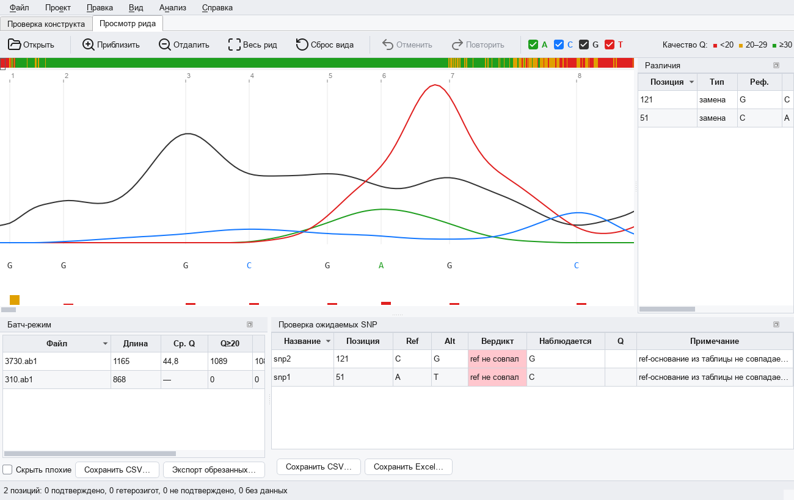
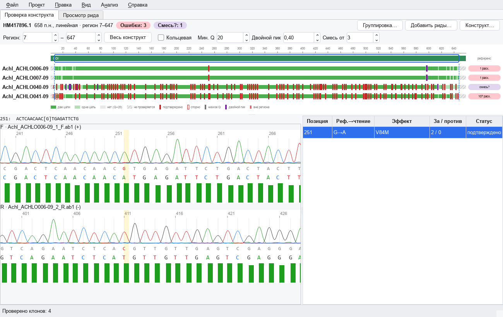
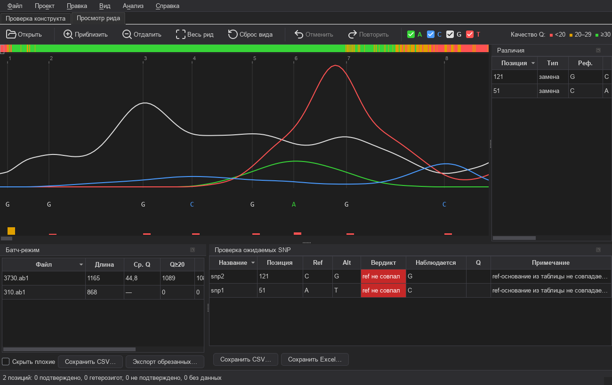
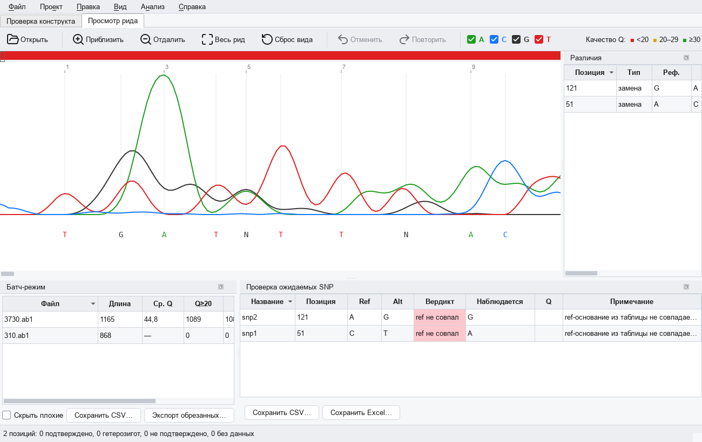

# ab1kit

Open-source desktop tool for viewing, editing and analyzing Sanger sequencing
chromatograms (`.ab1` files) — a free, offline alternative to FinchTV / Chromas
for everyday molecular biology lab work. English/Russian interface.




## Features

**Viewer**

- Parse ABIF (`.ab1`): traces, phred quality, peak positions, base calls
- Smooth chromatogram viewer: zoom/scroll (wheel, keyboard, Ctrl+drag to zoom
  into a selection), position ruler, quality bars, per-base tooltips
- Whole-read minimap with quality map and optional quality profile
- Dark theme, per-channel (A/C/G/T) visibility, trace smoothing
- Find subsequence (Ctrl+F, IUPAC-aware, both strands), go to base (Ctrl+G)

**Editing & trimming**

- Manual base editing (change / insert / delete) with unlimited undo/redo
- Reverse-complement as a single undoable operation
- Quality trimming (sliding window, Chromas-style) with live preview,
  draggable trim handles
- FASTA / FASTQ (phred33) / PNG / PDF export; editing sessions are saved and
  restored automatically

**Batch mode**

- Scan a folder of `.ab1` files: per-file QC (length, mean Q, Q20, trim
  length), status marks, sorting, hiding bad reads
- Batch trim + export respecting per-file editing sessions; CSV summary

**Analysis**

- Reference alignment: exact semiglobal DP with affine gaps
  (Bio.Align.PairwiseAligner, free end gaps — read ends are never dropped),
  both read orientations, ambiguity flag for repetitive references
- SNP calling: homozygous vs heterozygous (double-peak detection by
  secondary/primary height ratio, IUPAC codes), low-quality flagging
- **Expected-SNP verification**: load a VCF/CSV/TSV of expected variants and
  get a verdict per position (confirmed / heterozygous / not found / no data /
  low quality / input-error guards), with marks on the chromatogram and
  CSV / Excel reports
- Send the current read to NCBI BLAST (opens results in the browser)




## Getting started

Requires Python 3.11+:

```
python -m venv .venv
.venv/Scripts/pip install -e ".[dev]"    # Windows; on POSIX: .venv/bin/pip
.venv/Scripts/python -m pytest           # run the test suite
.venv/Scripts/ab1kit                     # launch the GUI
```

`ab1kit` also accepts a file or folder argument. On Windows, a prebuilt
executable is available on the [Releases](https://github.com/adrobi/ab1kit/releases)
page.

## Keyboard shortcuts

| Shortcut | Action |
| --- | --- |
| Ctrl+O / Ctrl+Shift+O | open file / folder |
| wheel, Ctrl+drag | zoom / zoom to selection |
| ←→ PgUp/PgDn Home/End | navigate |
| + / − | zoom in / out |
| Ctrl+G | go to base |
| Ctrl+F / F3 | find subsequence / next match |
| Ctrl+Z / Ctrl+Y | undo / redo |
| Ctrl+R | reverse-complement |
| Ctrl+T | quality trimming |
| Ctrl+S | save editing session |
| Ctrl+L | load reference |
| Ctrl+Shift+V | check expected SNPs |

## Stack

Python 3.11+, PySide6 (Qt) GUI, BioPython for ABIF parsing and alignment.
Core logic (`chrom_core`) is UI-independent and covered by pytest. MIT
license — see [LICENSE](LICENSE).

## Contributing

Issues and pull requests are welcome at
[github.com/adrobi/ab1kit](https://github.com/adrobi/ab1kit).
Example chromatograms in `examples/` come from the
[BioPython test suite](https://github.com/biopython/biopython/tree/master/Tests/Abi)
(Biopython License).

## Status

v1.0.0 — viewer, editing, trimming, batch mode, alignment, SNP calling and
expected-SNP verification are all implemented. See [CHANGELOG.md](CHANGELOG.md).
